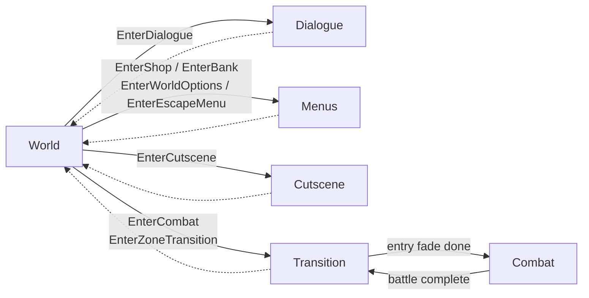

# Assets - Scripts : Core - PlayerStateMachine

This page covers the code and runtime behaviour of the [PlayerStateMachine](../PlayerStateMachine.cs). For prefab hook-up and controllers detail, see [Game/Core](../../../Game/Core/README.md) and [Game/Controllers](../../../Game/Controllers/README.md).

## Overview

The [PlayerStateMachine](../PlayerStateMachine.cs) sits on the [Player](../../../Game/Core/Player.prefab) and owns the player's high-level state: walking around (i.e. in world), in dialogue, in battle, in a menu, etc. Every other system asks it to change mode through its public `Enter*` methods, and listens for the result through `playerStateChanged`.

It follows a standard state machine pattern:
* **States** ([PlayerStates/](./PlayerStates/)) decide what a request means *from the current state*: accept it, ignore it, or queue it for later
* **Context** (`PlayerStateMachine`, via [IPlayerStateContext](./IPlayerStateContext.cs)) does the actual work: spawning controllers, starting fades, holding memory
* **Memory** ([PlayerStateMemory/](./PlayerStateMemory/)) holds the data for the request under consideration / the state in progress
* **Request Dispatcher** ([PlayerStateRequestDispatcher](./PlayerStateRequestDispatcher.cs)) makes sure one request finishes before the next one starts

| Folder / File                                                          | Contents                                                                                                                            |
|------------------------------------------------------------------------|-------------------------------------------------------------------------------------------------------------------------------------|
| [PlayerStateMachine.cs](../PlayerStateMachine.cs)                      | `MonoBehaviour` context: public `Enter*` API, `IPlayerStateContext` implementation, fader / battle callbacks, queue pop in `Update` |
| [PlayerStateType.cs](./PlayerStateType.cs)                             | Public enum that other systems see (`InWorld`, `InDialogue`, `InTransition`, `InBattle`, `InMenus`, `InCutScene`)                   |
| [IPlayerStateContext.cs](./IPlayerStateContext.cs)                     | Visible interface that a state may ask of the context                                                                               |
| [IPlayerStateInfo.cs](./IPlayerStateInfo.cs)                           | Read-only slice passed to `playerStateChanged` listeners                                                                            |
| [PlayerStates/](./PlayerStates/)                                       | `PlayerStateBase` (default rules) + one class per state                                                                             |
| [PlayerStateMemory/](./PlayerStateMemory/)                             | `ActionMemory` (queue) + ~one memory class per state                                                                                |
| [PlayerStateRequestDispatcher.cs](./PlayerStateRequestDispatcher.cs)   | Run-to-completion guard for nested requests                                                                                         |
| [PlayerStateDependentToggler.cs](./PlayerStateDependentToggler.cs)     | Scene helper: enables its children only in the listed states                                                                        |
| [PlayerStateOverrideToCutscene.cs](./PlayerStateOverrideToCutscene.cs) | Scene helper: enters a cutscene on enable, returns to World on disable                                                              |

## States

There are seven state objects, kept as shared `static readonly` instances on `PlayerStateMachine` (they hold no data, so they're safe to share). `TradeState` and `OptionState` both report `InMenus`.



Solid arrows are requests, and dotted arrows are the return to World (`EnterWorld`, or a fade / zone move completing). Note that every state can also move to Transition when a zone transition starts (not shown here, on account of it makes the diagram ugly).

### How Each State Handles Requests

`PlayerStateBase` supplies the defaults, and each state overrides only what differs. On terminology for the below table:
* "Queue" means the request goes to [ActionMemory](#actionmemory--the-policy-queue) and replays after the next return to World
* "Ignore" means the request is dropped.

| Current state ↓ / Request → | **World**                                  | **Transition**                                            | **Combat**                                                               | **Dialogue**                           | **Trade**     | **Options**     | **Cutscene**                           |
|-----------------------------|--------------------------------------------|-----------------------------------------------------------|--------------------------------------------------------------------------|----------------------------------------|---------------|-----------------|----------------------------------------|
| **Base default**            | Clear memory → World                       | → Transition if zone, else ignore                         | Queue                                                                    | Queue                                  | Ignore        | Ignore          | Queue                                  |
| **World**                   | *(default)*                                | → Transition                                              | Validate → set up battle → Transition → start fade                       | Set up controller → start → Dialogue   | Start → Menus | Start → Menus   | Hide party if needed → Cutscene        |
| **Transition**              | Hold if zone move incomplete, else default | *(default)*                                               | Battle entry (else ignore): fade done → Combat, else add enemies (swarm) | Queue during battle entry, else ignore | *(default)*   | *(default)*     | Queue during battle entry, else ignore |
| **Combat**                  | *(default)*                                | Battle exit: → Transition + exit fade. Zone: → Transition | Ignore                                                                   | *(default)*                            | *(default)*   | *(default)*     | *(default)*                            |
| **Dialogue**                | *(default)*                                | *(default)*                                               | *(default)*                                                              | *(default)*                            | Queue         | *(default)*     | *(default)*                            |
| **Trade / Options**         | *(default)*                                | *(default)*                                               | *(default)*                                                              | *(default)*                            | *(default)*   | *(default)*     | *(default)*                            |
| **Cutscene**                | Show party → clear → World                 | Zone only: show party → Transition                        | *(default)*                                                              | *(default)*                            | *(default)*   | *(default)*     | Queue new one → World (plays next)     |

Things worth knowing from the table:
* **Options and Trade are never queued** 
  * `EnterWorldOptions` / `EnterEscapeMenu` don't set an action under consideration -> pressing a menu key mid-dialogue is just ignored
  * Trade is the exception inside Dialogue (a shop opened from a dialogue choice), where it queues
* **Zone transitions win from anywhere** 
  * Any state moves to Transition when a zone transition is in progress (the scene is about to change under it)
* **World entries start and then commit** 
  * `WorldState.EnterDialogue` / `EnterOptions` / `EnterTrade` only call `SetPlayerState` once the controller or menu has actually started
  * If the start fails (empty dialogue, empty shop, missing prefab), memory is cleared and the player stays in World with no state change event
* **A closing dialogue controller is not reused.** 
  * If `SetupDialogueController` finds the previous controller still closing, `WorldState` queues the request and asks for a queue pop directly, so it replays next frame on a fresh controller

## Request Lifecycle

Every public `Enter*` method has the same shape:

```csharp
public void EnterShop(Shop shop)
{
    if (shopper == null || shop == null) { return; }                 // 1. Cheap argument guards, outside the dispatcher

    requestDispatcher.Run(nameof(EnterShop), () =>                   // 2. Run-to-completion
    {
        actionMemory.SetActionUnderConsideration(                    // 3. Remember how to replay this request
            PlayerStateType.InMenus, () => EnterShop(shop));
        shopper.SetShop(shop);                                       // 4. Fill the relevant memory
        tradeMemory.tradeData = new TradeData(shop.GetShopType());
        currentPlayerState.EnterTrade(this);                         // 5. Let the current state decide
    });
}
```

Then we commit the change inside `SetPlayerState`:
1. Swaps `currentPlayerState`
2. Raises `playerStateChanged` to all listeners
3. Sets ActionMemory's ready-to-pop flag (true only for World ~ ensures that other state clears a stale flag)
4. Chains any queued combat requests inline (for battle entry transitions ~ see [Swarm](#combat-entry-and-swarm))

`ClearPlayerStateMemory` runs on every return to World and on a failed start. It drops the controller references, the shopper's shop / bank, the action under consideration, and resets every memory class. **The ActionMemory queue itself is kept**, since that's what replays after the return to World.

### Who Calls In

| Request                                           | Typical callers                                                                                                                                               |
|---------------------------------------------------|---------------------------------------------------------------------------------------------------------------------------------------------------------------|
| `EnterWorld`                                      | Controllers and menus closing (`DialogueController`, `ShopBox`, `WorldOptions`, `EscapeMenu`, `BaseControllerExtensions`), `ZoneHandler`, `PlayerMenuHandler` |
| `EnterZoneTransition` / `SetZoneTransitionStatus` | `ZoneHandler`                                                                                                                                                 |
| `EnterCombat`                                     | `NPCStateHandler`                                                                                                                                             |
| `EnterDialogue`                                   | `AIConversant`, `NPCStateHandler`, `Check*` interactions + configurations, `ZoneHandler`, `World*GiverTaker`                                                  |
| `EnterShop` / `EnterBank`                         | `Shop`, `BankOptionCheckConfiguration`                                                                                                                        |
| `EnterWorldOptions` / `EnterEscapeMenu`           | `PlayerController`                                                                                                                                            |
| `EnterCutscene`                                   | `Player` (game over), `PlayerMenuHandler`, `WorldFaderInterface`, `WorldGameCompletion`, `WorldSubwayRider`, `PlayerStateOverrideToCutscene`                  |

`playerStateChanged` listeners include:
* `Player`
* `PlayerController`
* `PlayerMover`
* `Party`
* `NPCStateHandler`
* `PersistentStatus`
* `PlayerStateDependentToggler`

Several of these react by requesting another state (e.g. `Player` enters a cutscene and queues GameOver when the party is dead), which is handled by the [PlayerStateRequestDispatcher.cs](./PlayerStateRequestDispatcher.cs).

## Two Types of Queues

There are two separate queues:

|                 | PlayerStateRequestDispatcher                                                                     | ActionMemory                                                                                           |
|-----------------|--------------------------------------------------------------------------------------------------|--------------------------------------------------------------------------------------------------------|
| **Issue*        | A request arrives *while another request is under consideration* (chained during Enter* methods) | A request arrives, but the settled state doesn't want it *yet* (e.g. enter cutscene while in dialogue) |
| **Who decides** | Automatic: any nested call                                                                       | The current state's rules (i.e. per the table above)                                                   |
| **Order**       | FIFO                                                                                             | LIFO                                                                                                   |
| **Replays**     | Before the outermost `Enter*` call returns (same call stack)                                     | A frame after a return to World (`Update` + 1-frame skip)                                              |
| **Cleared**     | Never needs to be (always drains empty)                                                          | On `EnterZoneTransition`                                                                               |

Notably: requests can go through both queues: deferred by the dispatcher, and then (once it runs) queued by the state it lands in.

### PlayerState Request Dispatcher

`Enter*` calls have side effects that can call back into the state machine before they finish: `playerStateChanged` listeners, designer-wired `DialogueTrigger` / `UnityEvent`s, `Awake` / `OnEnable` on spawned UI, synchronous fader callbacks.  This results in uncontrolled run-to-completion behaviour that can have all kinds of bad / ill-defined impacts.

The dispatcher thus gives the state machine [run-to-completion semantics](https://en.wikipedia.org/wiki/UML_state_machine#Run-to-completion_execution_model):
* Core Behaviour:
  * `Run(name, request)` executes immediately at the outermost level
  * A call made while another request is running is queued (with an Info log) and drained (FIFO) just before the outermost call returns
* Callers stay synchronous: a top-level `EnterDialogue(...)` has committed by the time it returns, so things like `SetPostDialogueCallbackActions` straight afterwards still work
* A drained request is handled like any other: its state may accept it, ignore it, or push it to ActionMemory
* Each drained request runs in its own try/catch (exceptions are logged and the drain continues) ~ an exception in the outermost request still drains the queue before propagating
* The drain is capped at 16 requests (past that it logs a Warning and drops the rest ~ this is expected to be abnormal behaviour / potential request loop)

Tracked state:

| Field              | Meaning                                                                                                |
|--------------------|--------------------------------------------------------------------------------------------------------|
| `depth`            | How many requests are currently executing on the stack                                                 |
| `inlineDepth`      | Depth at which requests run immediately (0 normally, raised inside `RunInline`)                        |
| `draining`         | A drain loop is running, so a nested `Drain()` returns early and the drain stays as a single flat loop |
| `deferredRequests` | FIFO of requests waiting for the current one to finish                                                 |

**`RunInline(action)`** is the single exception to the standard FIFO-queued operation. Requests made *directly* by `action` run immediately, at the current depth; anything they request in turn defers as normal. It covers exactly one level, and an inline request that wants its own children inline has to call `RunInline` again. Since inline requests never enter the queue, the drain cap doesn't bound them (only the code calling them does). Today the only caller is the swarm chain in `SetPlayerState`.

<details>
<summary>Worked example: 7 requests, 2 inline</summary>

```C#
dispatcher.Run("R1", () =>
{
    dispatcher.Run("R2", () => dispatcher.Run("R5", () => { }));
    dispatcher.RunInline(() => dispatcher.Run("R3", () =>            // inline
        dispatcher.Run("R4", () => dispatcher.RunInline(() =>
            dispatcher.Run("R6", () =>                               // inline, during the drain
                dispatcher.Run("R7", () => { }))))));
});
```

| Event                                             | depth | inlineDepth | draining | Queue    |
|---------------------------------------------------|-------|-------------|----------|----------|
| `Run(R1)` executes                                | 1     | 0           | F        | []       |
| R1 → `Run(R2)` deferred                           | 1     | 0           | F        | [R2]     |
| `RunInline` → `Run(R3)` executes now              | 2     | 1           | F        | [R2]     |
| R3 → `Run(R4)` deferred (one level only)          | 2     | 1           | F        | [R2, R4] |
| R3 returns, inline scope ends, R1 returns → drain | 0     | 0           | T        | [R2, R4] |
| R2 runs → `Run(R5)` deferred                      | 1     | 0           | T        | [R4, R5] |
| R4 runs → `RunInline` → `Run(R6)` executes now    | 2     | 1           | T        | [R5]     |
| R6 → `Run(R7)` deferred                           | 2     | 1           | T        | [R5, R7] |
| R5, then R7 run; queue empty                      | 0     | 0           | F        | []       |

Order: R1 → **R3** → R2 → R4 → **R6** → R5 → R7. Inline requests jump the queue, and everything has run before `Run(R1)` returns.

</details>

### Action Memory:  Policy Queue

Each queueable `Enter*` stores an *action under consideration*: its `PlayerStateType` plus a closure that replays the original call. That pair is pushed onto a stack when a state decides to queue (`QueueActionUnderConsideration`).

Popping:
1. `SetPlayerState(World)` sets the ready-to-pop flag
   * any other state clears it
   * as such, a flag left over from a World that was immediately replaced (e.g. game over) can't pop mid-cutscene
2. `PlayerStateMachine.Update` sees the flag, consumes it, and starts `TryPopQueue`, after waiting one frame (via `_queuePopFrameSkips`)
   * this avoids the situation of a controller spawning on the same frame as the previous one that is being destroyed
3. One action is popped and replayed (back through the dispatcher as a fresh request)
4. If that action was a combat request, any further combat requests on top of the stack are chained straight after it

`EnterZoneTransition` clears the stack ~ queued actions do not / cannot carry across zones.

## Flows

### Combat Entry and Swarm

1. `NPCStateHandler` → `EnterCombat(enemies, transitionType)` → `WorldState.EnterCombat`
2. Set up the `BattleController` (and subscribe to `BattleStateChangedEvent`), confirm enemies (capped at `maxEnemiesPerCombat`), confirm transition type
3. `SetPlayerState(Transition)`. 
   * as a battle-entry transition, this chains any queued combat requests **inline**
   * each one lands in `TransitionState.EnterCombat`, which adds its enemies to the same battle
4. Start the entry fade ~ if the fade can't start, fall back to World
5. While the fade runs, any other NPC calling `EnterCombat` also lands in `TransitionState` and joins the battle (the swarm mechanic), while dialogue and cutscene requests are queued
6. Fade peak: spawn the battle UI (i.e. behind the opaque battle swirl/transition overlay), raise `BattleFadePhase.EntryPeak`
7. Fade complete: `combatFadeComplete = true`, `TransitionState.EnterCombat` → Combat, raise `EntryComplete`

The chain in step 3 runs inline rather than deferred because a synchronous fader completion (step 7) could otherwise move to Combat before the queued enemies are added.

### Combat Exit

1. `BattleState.Complete` → `HandleCombatMessages`: unsubscribe, and then set `BattleComplete` + request a transition
2. `CombatState.EnterTransition` → Transition: start the exit fade (fall back to World if it can't start)
3. Fade peak: raise `ExitPeak`, start the post-combat immunity window (`immunityTimePostCombat`)
4. Fade complete: raise `ExitComplete`, destroy the battle UI, `TransitionState.EnterWorld` → World (then the queue pops)

### Dialogue

1. `EnterDialogue(...)` → `WorldState.EnterDialogue` → find or spawn the `DialogueController`
2. `DialogueController.InitiateConversation` ~ note: will return false for an empty or fully gated dialogue (in which case, the player stays in World)
3. Otherwise → Dialogue ~ note: `DialogueInitiated` triggers fire inside the request, and anything they request gets deferred until the dialogue has committed
4. On close:  `EndConversation` marks the controller as closing, calls `EnterWorld`, then fires `onExitDialogue` on the conversant, then `DialogueComplete` triggers
   * a dialogue requested from those triggers waits for a fresh controller (see the closing-controller retry above)

### Zone Transition

1. `ZoneHandler` → `EnterZoneTransition`: clear the ActionMemory stack, mark a zone transition as in progress, → Transition from any state
2. `TransitionState.EnterWorld` is held off until the move completes
3. `ZoneHandler` → `SetZoneTransitionStatus(true)` + `EnterWorld` → World

## Extending

When adding a request or state:
* Keep argument guards **outside** `requestDispatcher.Run` and everything else inside it
  * * Fader / event-bus callbacks that change state go through `requestDispatcher.Run` too
* Set an action under consideration if the request should be queueable
* Let the state decide, through `currentPlayerState.EnterX(this)` ~ do **not** call `SetPlayerState` from outside a state
* For anything that starts a controller or menu: start first, commit with `SetPlayerState` only on success, and `ClearPlayerStateMemory` on failure
* Only make use of `RunInline` when nested work must happen *inside* the current transition
  * Critically:  make sure whatever it calls is bounded
  * An inline point is safe only once the outer request:
    * has committed its state (`SetPlayerState`), so inline requests land in the new state rather than the old one
    * has finished reading its inputs (the shared "under consideration" memory), since inline requests overwrite them
    * has nothing left to do that pushes to `ActionMemory`
  * Hot Tips:
    * never wrap `EnterZoneTransition` in `RunInline`
    * never open an inline point between its `ClearQueuedActions` and ZoneTransition's move to Transition (otherwise it will carry those into the new zone)
* A new state needs a `static readonly` instance tagged `[NoAutoStaticsCleanup]`

## Tests

| Test file                                                                                         | Mode  | Covers                                                                                            |
|---------------------------------------------------------------------------------------------------|-------|---------------------------------------------------------------------------------------------------|
| [PlayerStateRequestDispatcherTests](../../Tests/Editor/Core/PlayerStateRequestDispatcherTests.cs) | Edit  | Immediate vs deferred, FIFO drain, one-level inline, exception isolation, drain cap               |
| [WorldStateTests](../../Tests/Editor/Core/WorldStateTests.cs)                                     | Edit  | Dialogue / trade / option start failures, closing-controller retry (via `FakePlayerStateContext`) |
| [TransitionStateTests](../../Tests/Editor/Core/TransitionStateTests.cs)                           | Edit  | Combat requests: commit on fade done, swarm during fade, dropped outside a battle entry           |
| [TradeMemoryTests](../../Tests/Editor/Core/TradeMemoryTests.cs)                                   | Edit  | Shop start checks (missing / empty shop)                                                          |
| [PlayerStateOrderingTests](../../Tests/PlayMode/Core/PlayerStateOrderingTests.cs)                 | Play  | Listener ordering when a listener requests a new state, stale ready-to-pop flag                   |
| [DialogueStateFlowTests](../../Tests/PlayMode/Speech/DialogueStateFlowTests.cs)                   | Play  | Empty / gated start, `onExitDialogue` timing, trigger re-entrancy, closing-controller retry       |
| [ShopStateFlowTests](../../Tests/PlayMode/Inventory/ShopStateFlowTests.cs)                        | Play  | Empty shop, `transactionCompleted` relay incl. a shop opened from dialogue                        |
| [BattleControllerRetireTests](../../Tests/PlayMode/Combat/BattleControllerRetireTests.cs)         | Play  | `ExitComplete` retire vs. a controller requested the same frame                                   |

Not yet covered: zone transitions, the full combat flow (fades), and swarm chain.

### Additional Test Notes

* `PlayerStateRig` spawns the  Player, WorldUIRoot and Fader prefabs
  * Play Mode tests are coupled to those prefabs' contents (e.g. a living party, a party knapsack)
* Ordering tests use a stand-in listener rather than a real party death (that would queue the GameOver scene)
* `DialogueTrigger`, `AIConversant` and `Shop` expose small `internal` hooks for the tests.
